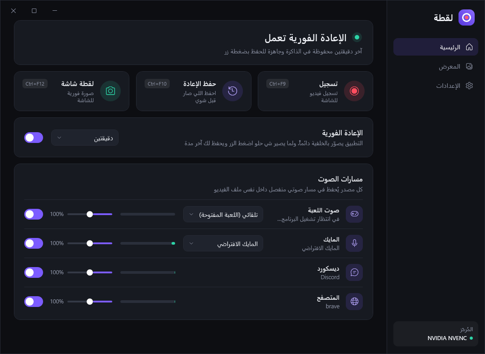
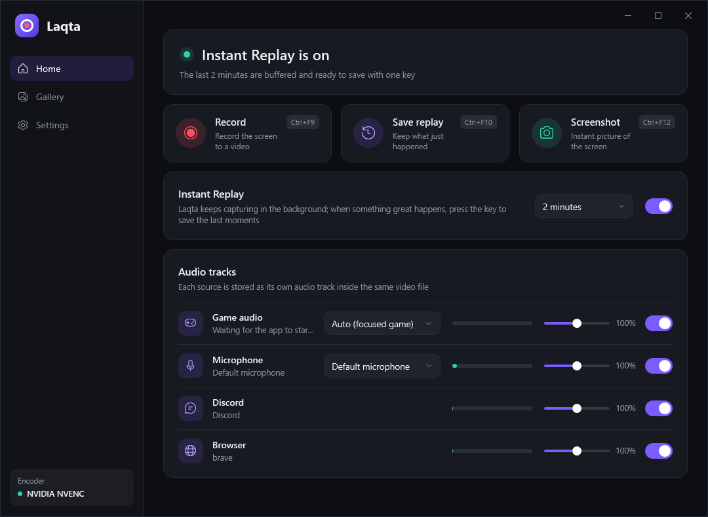

# لقطة · Laqta

تطبيق ويندوز لتصوير الشاشة: تسجيل فيديو، **إعادة فورية** (اضغط زر واحفظ اللي صار قبل دقيقتين)، ولقطات شاشة — مع **مسار صوت منفصل لكل مصدر** داخل نفس ملف الفيديو.

A Windows screen recorder with **instant replay**, screenshots, and a **separate audio track per source** (game, microphone, Discord, browser) inside one MP4.



## المميزات

- **مسارات صوت منفصلة** في نفس المقطع: صوت اللعبة، المايك، ديسكورد، المتصفح — ومسار خامس مدموج عشان المقطع يشتغل بكل أصواته في أي مشغّل. في برامج المونتاج (Premiere / DaVinci Resolve) يطلع كل مسار لحاله.
- **إعادة فورية**: التطبيق يصوّر بالخلفية دائماً، واختصار واحد يحفظ آخر 30 ثانية إلى 10 دقائق.
- **تسجيل عادي** بزر بدء/إيقاف، و**لقطة شاشة** فورية PNG.
- ترميز بكرت الشاشة (NVENC / AMF / Quick Sync) مع اختيار تلقائي، وx264 كبديل.
- الحفظ فوري بدون إعادة ترميز.
- اختصارات عامة تشتغل داخل الألعاب، قابلة للتغيير.
- واجهة داكنة بالعربية والإنجليزية، ويشتغل من شريط المهام.

| الوظيفة | الاختصار الافتراضي |
| --- | --- |
| بدء / إيقاف التسجيل | `Ctrl+F9` |
| حفظ الإعادة الفورية | `Ctrl+F10` |
| لقطة شاشة | `Ctrl+F12` |

## المتطلبات

- Windows 10 (إصدار 2004 أو أحدث) أو Windows 11
- [.NET 10 Desktop Runtime](https://dotnet.microsoft.com/download/dotnet/10.0)
- FFmpeg:

```
winget install Gyan.FFmpeg
```

## التشغيل من المصدر

```
dotnet run --project src/Laqta -c Release
```

لبناء نسخة جاهزة:

```
dotnet publish src/Laqta -c Release -o publish
```

## How it works

- **Video** — FFmpeg grabs the desktop with the Desktop Duplication API (`ddagrab`) and encodes on the GPU. At startup Laqta test-encodes a few frames with each capture/encoder combination and keeps the first that works.
- **Audio** — each track is a WASAPI capture: the microphone directly, and the game / Discord / browser through *process loopback*, which hears only one process tree. A clock-driven mixer interleaves all tracks into a single multichannel PCM stream over a named pipe, so tracks stay sample-locked; FFmpeg splits the channels back into separate AAC tracks.
- **Instant replay and recording** — FFmpeg continuously writes 4-second MPEG-TS segments to a rolling buffer in `%LOCALAPPDATA%\Laqta\buffer`. Saving a replay or stopping a recording just stream-copies the matching time range into an MP4, so it takes a moment regardless of quality.
- **Game detection** — in Auto mode the game track follows the focused app (ignoring Discord, browsers and shell windows) and sticks to a fullscreen app once it has seen one. You can also pick the app by hand.



## Known limits

- Only monitors attached to the primary GPU are listed.
- Exclusive-fullscreen games may not be visible to Desktop Duplication; use borderless/windowed fullscreen.
- Protected (DRM) video is black in captures, as with every screen recorder.
- A browser opened *by* Discord (clicking a link while no browser is running) counts as part of Discord's process tree.

## Developer checks

```
Laqta.exe --selftest <folder> [gameProcessName]   # headless capture → replay → recording → screenshot
Laqta.exe --snapshot <folder>                     # render every page to PNG in both languages
tools/hotkey-test.ps1                             # live global-hotkey test against the real app
```
